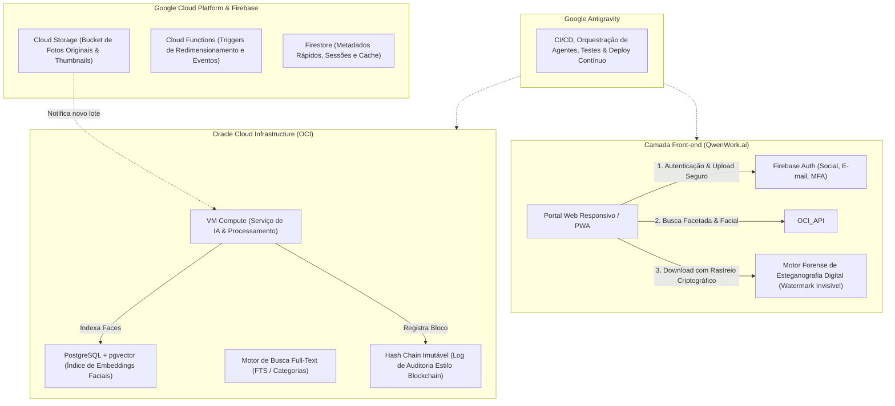
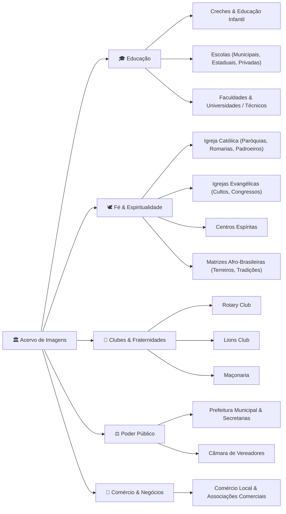
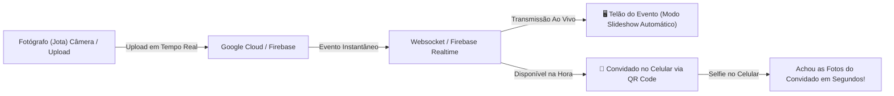

# PROPOSTA DE ARQUITETURA TÉCNICA & INTEGRAÇÃO DE SISTEMA
## Plataforma de Banco de Imagens, Acervo Histórico e Galeria com Reconhecimento Facial & Auditoria Imutável

---

**Destinatário:** Equipe Técnica & Engenharia de Produto – **QwenWork.ai**  
**Versão:** 1.0  
**Ambiente de Desenvolvimento & Orquestração:** Google Antigravity  

---

## 1. Sumário Executivo

Este documento consolida a arquitetura técnica de uma plataforma completa de **Galeria Inteligente, Banco de Imagens e Acervo Histórico Municipal/Regional**. 

A infraestrutura de backend, processamento de Inteligência Artificial e armazenamento já está em pleno funcionamento e provisionada em modelo **multi-nuvem híbrido (Google Cloud Platform + Oracle Cloud Infrastructure)**, assegurando alta disponibilidade, baixíssima latência e otimização drástica de custos computacionais.

O objetivo desta especificação é alinhar a camada de interface e experiência de usuário (Front-end) desenvolvida junto ao **QwenWork.ai** com os serviços já existentes.

---

## 2. Mapa Geral da Infraestrutura Híbrida

A arquitetura reparte de forma ótima as responsabilidades computacionais:

---

## 3. Divisão de Responsabilidades por Componente

### 3.1. Google Cloud Platform & Firebase
* **Firebase Authentication:** Gestão completa de identidade para fotógrafos, administradores de entidades e visitantes comuns.
* **Google Cloud Storage:** Armazenamento massivo de fotos em alta resolução (`raw/original`) e formatos web otimizados (`webp/avif`).
* **Cloud Functions:** Processamento *serverless* disparado imediatamente no upload para geração de miniaturas leves e emissão de mensagens para a fila da VM.
* **Firestore:** Banco de baixa latência para estados da interface, permissões de usuários e contadores rápidos.

### 3.2. Oracle Cloud Infrastructure (OCI)
* **VM Compute (Carga Pesada de IA):**
  * Detecção e extração de rostos via modelos de ponta (*InsightFace / ArcFace / FaceNet*).
  * Geração de vetores matemáticos (*embeddings* de 512 dimensões por face identificada).
* **Banco de Dados Relacional & Vetorial (PostgreSQL + pgvector):**
  * Busca de similaridade facial instantânea (cálculo de distância por cosseno).
  * Pesquisa textual rápida (Full-Text Search) com dicionários de português (tratamento de acentos e sinônimos).
* **Camada de Criptografia e Rastreio:**
  * Motor de esteganografia para assinatura de pixels em downloads.
  * *Ledger* de eventos imutáveis com encadeamento de hash SHA-256.

### 3.3. Google Antigravity
* Pipeline unificado de integração e deploy (CI/CD).
* Governança de código e suporte a inspeção visual rápida via **Target Mode** (`Ctrl+Shift+H`).

---

## 4. O Acervo & Taxonomia de Entidades

O sistema opera como um acervo histórico e contemporâneo estruturado nas seguintes categorias e entidades:

### Critérios de Busca e Filtros Facetados:
1. **Entidade / Instituição:** Seleção direta ou múltipla.
2. **Tipo de Evento:** Posse de diretoria, sessões solenes, festas de padroeiro, formaturas, desfiles, congressos.
3. **Datas Comemorativas / Festivas:** 7 de Setembro, Consciência Negra, Festas Juninas, Natal, Aniversário do Município.
4. **Filtro Temporal:** Ano, década ou intervalo de datas (DD/MM/AAAA).
5. **Busca Híbrida (Face + Texto):** Exemplo: *"Buscar fotos de [Pessoa X] em eventos do [Lions Club] entre [2018 e 2022]"*.

---

## 5. Auditoria Imutável, Direitos Autorais & Rastreabilidade (Blockchain-Like)

Para proteger o acervo e manter auditoria total de uso:

### 5.1. Livro-Razão Criptográfico (Hash Chaining)
Toda interação significativa com o acervo é registrada como um bloco criptográfico imutável:
$$\text{Hash}_N = \text{SHA256}(\text{Hash}_{N-1} \parallel \text{UserID} \parallel \text{FotoID} \parallel \text{Ação} \parallel \text{Timestamp})$$
* **Eventos Auditados:**
  * Termos de pesquisa executados.
  * Fotos visualizadas em modo expandido.
  * Downloads efetuados (com identificação de quem baixou).
  * Links de compartilhamento gerados para terceiros.

### 5.2. Esteganografia Forense (Watermark Invisível)
* No momento do download ou compartilhamento, um identificador criptográfico invisível é embutido na malha de pixels da imagem.
* Caso uma foto seja copiada, publicada na internet ou utilizada indevidamente, o leitor forense na VM Oracle permite comprovar:
  * ID do usuário que efetuou a extração;
  * Data e horário exatos da transferência;
  * Certificado de autenticidade e autoria da foto original.

---

## 6. Módulo "Ao Vivo": Modo Telão (Live Slideshow) & Entrega Imediata

Este é o diferencial de maior impacto comercial e urgência do produto: **o evento ainda está acontecendo, as fotos sobem na hora e o público já interage imediatamente**.

### 6.1. O Modo Telão & Modo Sala de Estar / Home Theater (Google Cast / Smart TV / AirPlay)
* **Experiência Multi-Cenário (No Evento ou no Conforto de Casa):**
  * **No dia do evento:** Projeção ao vivo no telão do salão.
  * **Pós-evento (Família reunida):** O cliente chega em casa e, com um toque no celular, transmite todo o álbum ou suas fotos selecionadas para a **TV da sala / Home Theater** via **Google Cast / Chromecast, AirPlay ou Smart View**.
* **Botão Nativo de Transmissão ("Cast to TV"):**
  * O player do site inclui o botão padrão de transmissão de mídia para que qualquer pessoa mande o slideshow direto para a TV sem precisar conectar cabos HDMI.
* **Áudio Ambiente para Home Theater:**
  * Opção de trilha sonora suave (música instrumental de fundo) com transição de som estéreo/surround para uma experiência imersiva na sala.

* **🤖 Agente de IA "CineDirector" (Diretor de Transições & Ritmo):**
  * Para não depender de efeitos puramente aleatórios, o telão conta com um **Agente Autônomo de IA (CineDirector AI)** que analisa visualmente cada imagem antes de projetá-la e decide a melhor direção de cena:
    1. **Análise de Foco e Rosto:** Se a foto for um retrato de uma pessoa sorrindo, a IA comanda um *zoom suave direcionado exatamente no rosto do fotografado* (Crop Inteligente com IA).
    2. **Detecção de Fotos Coletivas / Panorâmicas:** Se a IA detectar 5 ou mais pessoas (ex: mesa de convidados, diretoria de entidade), ela aplica um *Pan lento horizontal* e aumenta o tempo de exibição para 7 segundos para que todos se identifiquem na tela.
    3. **Detecção de Orientação (Smart Split):** Se chegarem fotos verticais (formato Story/Reels), o agente agrupa 2 ou 3 fotos compatíveis e monta um mosaico dinâmico animado instantâneo.
    4. **Orquestrador de Emoção & Ritmo:** O agente varia dinamicamente entre múltiplos efeitos (Ken Burns orientado por face, Crossfade líquido, Slide com Motion Blur, Flash fotográfico e Zoom dinâmico), garantindo que **duas transições iguais nunca se repitam em sequência**.
    5. **Prioridade a Novidades ("Breaking News"):** Sempre que o Jota sobe uma foto recém-tirada (últimos 3 minutos), o agente insere a foto com um efeito de destaque com selo sutil *"Registrado agora há pouco"*.

* **Tempo de Exibição Variável Inteligente (3s a 7s):** Calculado pelo agente de acordo com a densidade de pessoas e detalhes na cena.
* **Atualização em Tempo Real (Zero Refresh):** Conforme novas fotos e vídeos sobem, o telão puxa automaticamente as novidades via WebSocket / Firebase Realtime sem piscar ou travar.
* **Modo Mídia Mista (Vídeo + Foto):** O agente alterna fotos com vídeos curtos gravados no evento, gerenciando transições de áudio com fade-in e fade-out.
* **QR Code Dinâmico no Canto da Tela:** Um QR code discreto no cantinho do telão dizendo:  
  * *"Aponte a câmera, tire uma selfie e veja suas fotos agora mesmo!"*

### 6.2. Entrega Imediata ("Jota, onde estão minhas fotos?")
* O convidado não espera dias nem semanas. Ele aponta o celular para o QR Code na mesa ou no telão.
* Tira uma selfie no celular e o reconhecimento facial entrega na hora apenas as fotos dele prontas para postar no Instagram/WhatsApp!

---

## 7. Escopo de Integração para a Equipe QwenWork.ai

Com a infraestrutura de dados e IA pronta, a integração com o QwenWork.ai concentra-se nas seguintes frentes:

1. **Interface do Usuário (Front-end):**
   * Barra de busca unificada com auto-complete inteligente.
   * Filtros dinâmicos laterais (facetas por Entidades, Anos, Eventos).
   * Visualização em mosaico (*Masonry Grid*) com suporte a rolagem infinita.
   * Modal com interface para **Upload de Selfie** e busca facial instantânea.
2. **Contratos de API (Endpoints já suportados pelo backend):**
   * `POST /api/v1/search/query` – Busca textual facetada.
   * `POST /api/v1/search/face` – Busca por similaridade facial via multipart (imagem de selfie).
   * `POST /api/v1/media/{id}/download` – Emissão de URL assinada com aplicação de esteganografia e registro em ledger.
   * `POST /api/v1/media/{id}/share` – Geração de link parametrizado rastreável.
3. **Página de Detalhes da Foto:**
   * Apresentação clara de metadados (entidade, data, local, fotógrafo).
   * Lista de rostos identificados na imagem com links cruzados.
   * Selo informativo de proteção criptográfica e direitos autorais.

---

**Documento pronto para homologação e alinhamento de sprints técnicas.**
